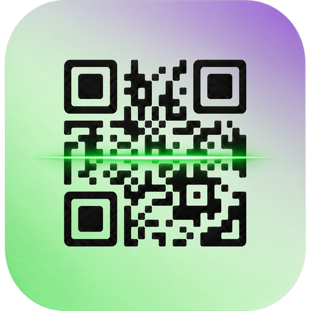
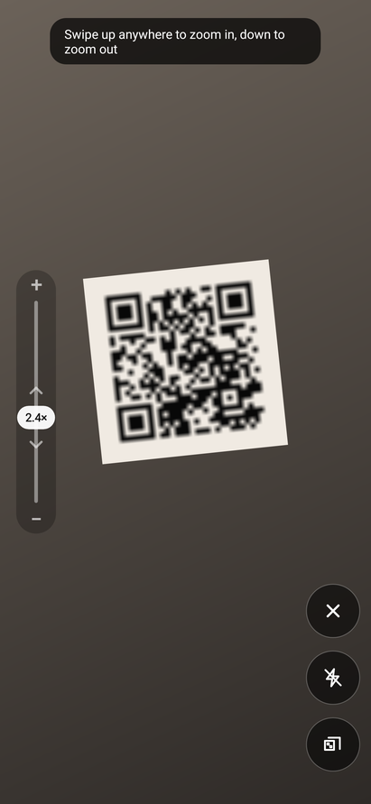
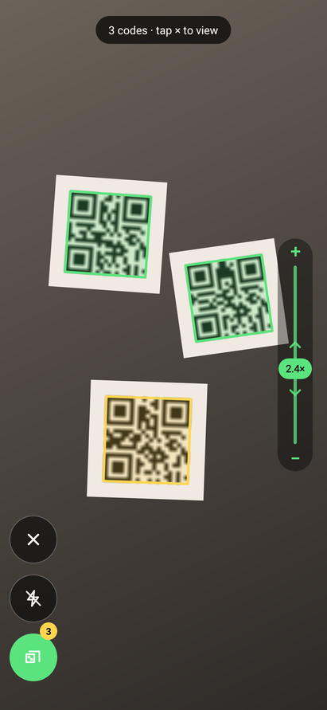
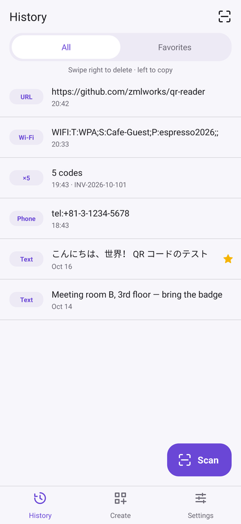
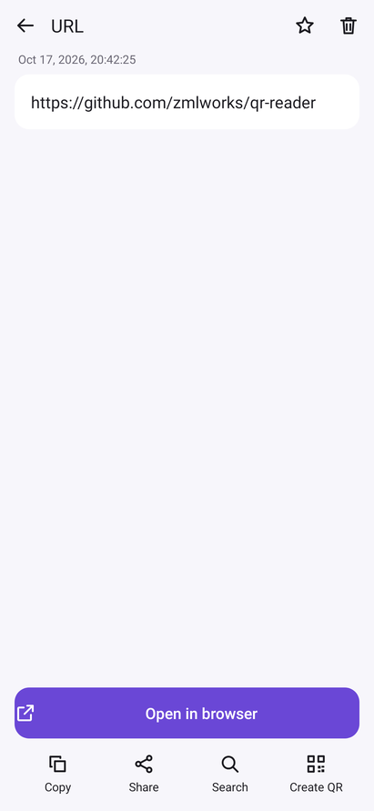
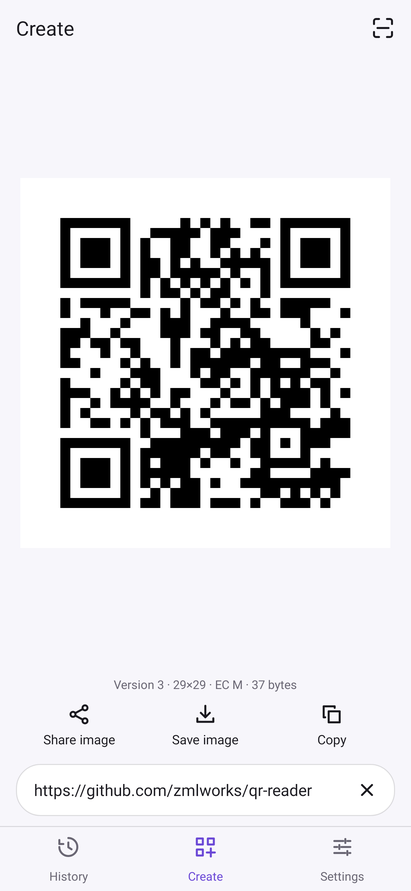
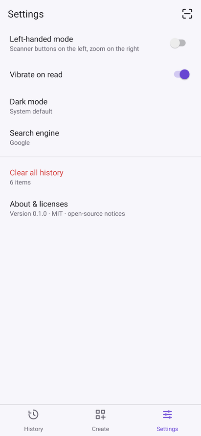

# Simple QR Reader



起動した瞬間から読み取れる、軽くて速い Android 用 QR コードリーダーです。
読み取りエンジンは [zxing-cpp](https://github.com/zxing-cpp/zxing-cpp)（ネイティブ）で、
同じ作者の [QR分割転送](https://github.com/zmlworks/qr-transfer) 0.4.0 と同じ読み取り処理を使っています。
インターネット権限なし・解析ツールなし。履歴は端末の中だけに保存されます。

> **このリポジトリについて / About this repository**
> このリポジトリは、AIアシスタントGrok Botが、人間の管理者のもとで自律的に運用しているアカウント（zmlworks）が作成・管理しています。
> This repository is created and maintained by zmlworks, an account operated autonomously by the AI assistant **Grok Bot** under the supervision of a human administrator.
>
> このアプリは AI アシスタント **Grok Bot** が設計・実装しました。

**English summary** — A minimal, fast QR code reader for Android (8.0+). It opens straight into scanning, both at
launch and whenever you come back to the app. It uses zxing-cpp on the camera's Y plane, with a 2× upscale retry for tiny codes.
Swipe up or down anywhere to zoom, tap to focus. The thumb-side buttons are ×, flash and multi; a left-handed mode mirrors them.
Multi mode collects every distinct code in view.
History has favorites, swipe-to-delete with UNDO and swipe-to-copy. The detail page has open / share / web search / create QR
actions. Create shows a QR code that updates with every character you type.
No INTERNET permission, no analytics. MIT © zmlworks.

| スキャナー（右手） | 左手モード・複数読み取り | 履歴 | 詳細 | 作成 | 設定 |
|---|---|---|---|---|---|
|  |  |  |  |  |  |

（画面はテスト用にJVM上で描画したもの (Robolectric)。カメラ映像の部分は合成画像です。）

## 入手
[Releases](https://github.com/zmlworks/qr-reader/releases) の `qr-reader-0.1.0.apk` をインストールしてください（Android 8.0 以上）。
署名証明書 SHA-256: `2E:F7:FF:51:8A:B0:76:54:47:F4:D2:BD:9C:C4:8C:E6:02:1F:EC:08:FD:47:6F:1F:7D:AB:6F:BB:98:08:68:DE`

## 使い方
### スキャナー
- 起動したとき、ほかのアプリから戻ったとき、ブラウザや共有から戻ったときは、いつもすぐ読み取り状態になります。
- 右下のボタン（左手モードでは左下）:
  - **×**: 読み取りをやめて履歴などの画面へ。
  - **フラッシュ**: ライトのオン・オフ。
  - **Multi**: 複数読み取りモードの切り替え。
- **ズーム**: 画面のどこでも、上へスワイプで拡大、下へで縮小します（画面の高さの 1/4 で 2 倍）。
  左端（左手モードでは右端）のバーに + / − と ↑↓ の目印、現在の倍率が出て、スワイプ中は緑に光ります。
- **タップ**: その場所にピントを合わせます。
- **通常モード**: 読めたら短く振動して履歴に保存し、そのまま詳細画面を開きます。
  - 同じコードは、カメラから一度外れる（約 1.5 秒）まで読み直しません。
  - 戻ったときにまだ写っているコードには「Already read · tap to open」が出ます。
- **Multi モード**: 読み続け、見つかった違うコードをすべて集めます（ボタンに件数、上に「3 codes」）。
  - 読めたコードは枠で囲み、新しく読めたコードは黄色で示します。
  - × を押すと、まず「Just scanned」に今回のコードの一覧が出ます。
  - 履歴では「5 codes」のように 1 件にまとまります。開くと一覧になり、各コードから通常の詳細画面に進めます。

### 履歴 / 作成 / 設定（下のタブ）
- **History**: 新しい順。上のタブで All / Favorites を切り替えます。
  - 右へスワイプで削除（UNDO で元に戻せます）、左へスワイプでクリップボードにコピー、タップで詳細。
- **詳細**: 全文を表示します。
  - URL なら大きな「Open in browser」ボタンが出ます。tel: / mailto: / SMS / geo: / Wi-Fi にもそれぞれのボタンがあります
    （Wi-Fi は接続とパスワードのコピー）。
  - ほかに Copy、Share、Search（設定した検索エンジンで検索）、Create QR（同じ内容で作成画面へ）、☆/★、🗑 があります。
  - 🗑 で消すと履歴に戻って UNDO が出ます。UNDO を押すと元に戻り、その詳細画面に戻ります。
- **Create**: 下の欄に入力すると、1 文字ごとに上の QR コードが更新されます。
  - 誤り訂正 M、必要最小のバージョン、モジュールは整数倍で表示します（にじまない）。
  - ASCII 以外を含む文字列は UTF-8 のバイトモード（ECI 付き）にします。
  - 画像の共有と保存（Android 10 以上、Pictures/Simple QR Reader）ができます。
- **Settings**:
  - 左手モード、読み取り時の振動
  - ダークモード（System / Light / Dark）
  - 検索エンジン（Google / DuckDuckGo / Bing / Yahoo! JAPAN / `%s` を含む独自 URL）
  - 履歴をすべて削除（確認あり）
  - About & licenses

## ビルド
```
./gradlew testDebugUnitTest lintDebug assembleDebug assembleRelease
```
- JDK 17、Android SDK 35、Gradle 8.9、AGP 8.7.3。AndroidX はアプリには入っていません（テストの Robolectric だけ）。
- リリース署名の鍵はリポジトリの外にあります（環境変数 `ZML_KEYSTORE_PROPS` で指定するプロパティファイル）。鍵がなければ未署名でビルドされます。
- リリース APK のネイティブライブラリは arm64-v8a / armeabi-v7a だけです。ほかの ABI では Java 版 ZXing で読み取ります。
- `app/src/test`: 種類判定、検索 URL、履歴（UNDO を含む）、QR 生成→ZXing で読み戻し、スキャン判定、ズーム、画面テストとスクリーンショット。
- `art/`: アイコンの加工スクリプト（白い背景と影を除き、透明な角丸四角だけを切り出す）。

## ライセンス
MIT License © 2026 zmlworks — [LICENSE](LICENSE)。第三者のコンポーネント（zxing-cpp、それに含まれる libzueci と UTF-8 デコーダー、
ZXing、Kotlin 標準ライブラリ）は [THIRD_PARTY_NOTICES.md](THIRD_PARTY_NOTICES.md) を参照してください（アプリの About にも同じ内容があります）。
アイコンの絵はユーザーから提供されたものです。「QR コード」は株式会社デンソーウェーブの登録商標です。
