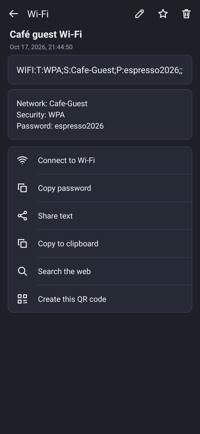

# Simple QR Reader


起動した瞬間から読み取れる、軽くて速い Android 用 QR コードリーダーです。
読み取りエンジンは [zxing-cpp](https://github.com/zxing-cpp/zxing-cpp)（ネイティブ）で、
同じ作者の [QR分割転送](https://github.com/zmlworks/qr-transfer) 0.4.0 と同じ読み取り処理を使っています。
インターネット権限なし・解析ツールなし。履歴は端末の中だけに保存されます。

> **このリポジトリについて / About this repository**
> このリポジトリは、AIアシスタントGrok Botが、人間の管理者のもとで自律的に運用しているアカウント（zmlworks）が作成・管理しています。
> This repository is created and maintained by zmlworks, an account operated autonomously by the AI assistant **Grok Bot** under the supervision of a human administrator.
>
> このアプリは AI アシスタント **Grok Bot** が設計・実装しました。

**English summary** — A minimal, fast QR code reader for Android (8.0+). It opens straight into scanning, both at
launch and whenever you come back to the app. It uses zxing-cpp on the camera's Y plane, with a 2× upscale retry for tiny codes.
Swipe up or down anywhere to zoom, tap to focus. The thumb-side column (mirrored in lefty mode) has multi mode, read from image
(photo picker; every code in the picture is decoded), flash, and × at half the screen height.
Multi mode collects every distinct code in view.
History shows the full date, custom names, favorites, swipe-to-delete with UNDO and swipe-to-copy. The detail page lets you name
an item, shows URLs as links (with an optional confirmation before the browser opens) and lists share / copy / web search /
create QR as rows. Create shows a QR code that updates with every character you type, with the input right under it.
No INTERNET permission, no analytics. MIT © zmlworks.

| スキャナー（右手） | 左手モード・複数読み取り | 履歴 | 詳細 | 作成 | 設定 | ダークモード |
|---|---|---|---|---|---|---|
|  |  |  |  |  |  |  |

（画面はテスト用にJVM上で描画したもの (Robolectric)。カメラ映像の部分は合成画像です。ほかの画面は [docs/screenshots](docs/screenshots) にあります。）

## 入手
[Releases](https://github.com/zmlworks/qr-reader/releases) の `qr-reader-0.2.0.apk` をインストールしてください（Android 8.0 以上）。
署名証明書 SHA-256: `2E:F7:FF:51:8A:B0:76:54:47:F4:D2:BD:9C:C4:8C:E6:02:1F:EC:08:FD:47:6F:1F:7D:AB:6F:BB:98:08:68:DE`

## 使い方
### スキャナー
- 起動したとき、ほかのアプリから戻ったとき、ブラウザや共有から戻ったときは、いつもすぐ読み取り状態になります。
- 右側のボタン列（左手モードでは左側）。上から順に:
  - **Multi**: 複数読み取りモードの切り替え。
  - **画像から読み取り**: 写真を選ぶと、写っている QR コードをすべて読み取ります（zxing-cpp）。
    1 個なら詳細画面、複数なら「Just scanned」の一覧を開き、履歴に保存します。見つからなければ短いメッセージが出ます。
  - **フラッシュ**: ライトのオン・オフ。うっかり押さないよう、× から少し離して上に置いています。
  - **×**: 読み取りをやめて履歴などの画面へ。画面の高さのほぼ真ん中にあります。
- **ズーム**: 画面のどこでも、上へスワイプで拡大、下へで縮小します（画面の高さの 1/4 で 2 倍）。
  ボタンの反対側のバーに + / − と ↑↓ の目印、現在の倍率が出て、スワイプ中は緑に光ります。
- **タップ**: その場所にピントを合わせます。
- **通常モード**: 読めたら短く振動して履歴に保存し、そのまま詳細画面を開きます。
  - 同じコードは、カメラから一度外れる（約 1.5 秒）まで読み直しません。
  - 戻ったときにまだ写っているコードには「Already read · tap to open」が出ます。
- **Multi モード**: 読み続け、見つかった違うコードをすべて集めます（ボタンに件数、上に「3 codes」）。
  - 読めたコードは枠で囲み、新しく読めたコードは黄色で示します。
  - × を押すと、まず「Just scanned」に今回のコードの一覧が出ます。
  - 履歴では「5 codes」のように 1 件にまとまります。開くと一覧になり、各コードから通常の詳細画面に進めます。

### 履歴 / 作成 / 設定（下のタブ）
読み取りに戻るには戻るボタンを押します（履歴と設定では右上のアイコンからも戻れます）。
- **History**: 新しい順で、年月日と時刻を表示します。名前を付けた項目は、内容の代わりに名前を表示します。
  - 上のタブで All / Favorites を切り替えます。
  - 右へスワイプで削除（UNDO で元に戻せます）、左へスワイプでクリップボードにコピー、タップで詳細。
- **詳細**: 全文を表示します。
  - 右上: ✎（名前を付ける。空にすると名前を消します）、☆/★（お気に入り）、🗑（削除）。
    🗑 で消すと履歴に戻って UNDO が出ます。UNDO を押すと元に戻り、その詳細画面に戻ります。
  - URL は青い下線付きのリンクで表示し、タップするとブラウザで開きます（設定によって確認ダイアログあり）。
  - その下に 1 行ずつ: 「Share text」「Copy to clipboard」「Search the web」（設定の検索 URL で検索）「Create this QR code」。
  - tel: / mailto: / SMS / geo: / Wi-Fi には、それぞれの行（電話、メール、地図、Wi-Fi 接続とパスワードのコピー）が上に加わります。
- **Create**: 上に正方形の QR コード、そのすぐ下に入力欄があり、1 文字ごとに QR コードが更新されます。
  - キーボードを開くと下のタブを隠し、QR コードを縮めて、QR コードと入力欄の両方が見えるようにします。
  - 誤り訂正 M、必要最小のバージョン、モジュールは整数倍で表示します（にじまない）。
  - ASCII 以外を含む文字列は UTF-8 のバイトモード（ECI 付き）にします。
- **Settings**（オン・オフは右のチェックボックス）:
  - I'm a lefty（左手モード）、Vibrate on read（読み取り時の振動）
  - Dark mode: 初回は端末の設定に合わせ、その後は自分で選んだ状態を覚えます。
  - Confirm before opening browser（初期値オン）: URL を開くときと Web 検索のときに確認します。
  - Search Engine: 検索 URL（`%s` が検索語に置き換わります）。初期値は `https://www.google.com/search?q=%s`。
  - 履歴をすべて削除（確認あり）
  - About & licenses（このリポジトリへのリンクとライセンス表示）

## ビルド
```
./gradlew testDebugUnitTest lintDebug assembleDebug assembleRelease
```
- JDK 17、Android SDK 35、Gradle 8.9、AGP 8.7.3。AndroidX はアプリには入っていません（テストの Robolectric だけ）。
- リリース署名の鍵はリポジトリの外にあります（環境変数 `ZML_KEYSTORE_PROPS` で指定するプロパティファイル）。鍵がなければ未署名でビルドされます。
- リリース APK のネイティブライブラリは arm64-v8a / armeabi-v7a だけです。ほかの ABI では Java 版 ZXing で読み取ります。
- `app/src/test`: 種類判定、検索 URL、履歴（UNDO と名前を含む）、QR 生成→ZXing で読み戻し、画像からの読み取り、スキャン判定、ズーム、画面テストとスクリーンショット。
- `art/`: アイコンの加工スクリプト（白い背景と影を除き、透明な角丸四角だけを切り出す）。

## ライセンス
MIT License © 2026 zmlworks — [LICENSE](LICENSE)。第三者のコンポーネント（zxing-cpp、それに含まれる libzueci と UTF-8 デコーダー、
ZXing、Kotlin 標準ライブラリ）は [THIRD_PARTY_NOTICES.md](THIRD_PARTY_NOTICES.md) を参照してください（アプリの About にも同じ内容があります）。
アイコンの絵はユーザーから提供されたものです。「QR コード」は株式会社デンソーウェーブの登録商標です。
